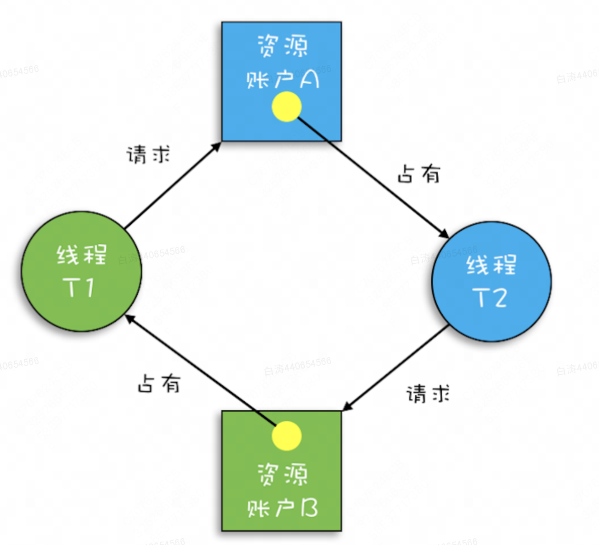

# 死锁

**一组互相竞争资源的线程因互相等待，导致“永久”阻塞的现象**。


## 死锁产生的例子

假设现在有一个银行转账的操作，转账时需要锁定转出账户和转入账户

```java
public class Account {
  	// 账户存款
    private int balance = 1000000000;
		
  	// 转账
    void transfer(Account target, int amt) {
      	// 锁定转出账户
        synchronized (this) {
          	// 锁定转入账户
            synchronized (target) {
                if (this.balance > amt) {
                    this.balance -= amt;
                    target.balance += amt;
                }
            }
        }
    }
}
```


假设账户A给账户B转100块钱，账户B同时给账户A转1000块钱，两个线程并发执行到锁定转出账户，之后二者都无法获取到转入账户，此时发生了死锁




## 死锁发生后怎么办

实话说没办法，通常只能重启（要求某个线程释放掉所有资源）


## 死锁发生的条件 & 预防死锁

1971 年Coffman总结出了系统产生死锁的四个必要条件：

1. 互斥，共享资源X和Y只能被一个线程占用；
2. 占有且等待，线程T1已经取得共享资源X，在等待共享资源Y的时候，不释放共享资源X；
3. 不可抢占，其他线程不能强行抢占线程T1占有的资源；
4. 循环等待，线程T1等待线程T2占有的资源，线程T2等待线程T1占有的资源，就是循环等待。


预防死锁，只需要破坏这四个条件任意一条即可。除去互斥条件无法破坏，其他都可以破坏掉。

### 1.破坏占有且等待

可以要求申请资源时必须一次性申请所有资源，这样的话如果线程持有资源就能保证正常执行。

```java
class Allocator {
  private List als =
    new ArrayList<>();
  // 一次性申请所有资源
  synchronized boolean apply(
    Object from, Object to){
    if(als.contains(from) ||
         als.contains(to)){
      return false;  
    } else {
      als.add(from);
      als.add(to);  
    }
    return true;
  }
  // 归还资源
  synchronized void free(
    Object from, Object to){
    als.remove(from);
    als.remove(to);
  }
}

class Account {
  // actr应该为单例
  private Allocator actr;
  private int balance;
  // 转账
  void transfer(Account target, int amt){
    // 一次性申请转出账户和转入账户，直到成功
    while(!actr.apply(this, target))
      ；
    try{
      // 锁定转出账户
      synchronized(this){              
        // 锁定转入账户
        synchronized(target){           
          if (this.balance > amt){
            this.balance -= amt;
            target.balance += amt;
          }
        }
      }
    } finally {
      actr.free(this, target)
    }
  } 
}

```


### 2.破坏不可抢占

synchronized关键字是没有办法破坏不可抢占的，本身这个关键字拿不到资源就是阻塞

juc包里的lock有办法解决，这里先不表


### 3.破坏循环等待条件

可以为系统中的资源指定顺序，必须有前面的资源才能申请后面的资源，这样就可以保证不会线程之前互相等待


