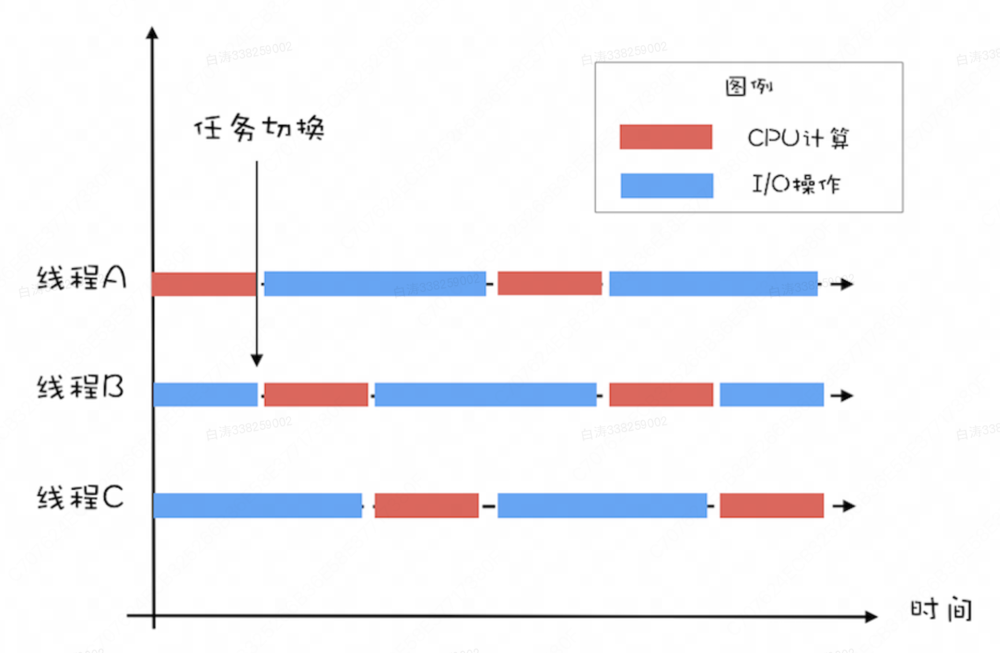

# Java线程

1.线程的生命周期：

一般来说，线程分成了：

- 初始状态：指的是线程已经被创建，但是还不允许分配CPU执行。这个状态属于编程语言特有的，不过这里所谓的被创建，仅仅是在编程语言层面被创建，而在操作系统层面，真正的线程还没有创建
- 可运行状态：没CPU执行
- 运行状态：有CPU执行
- 休眠状态：运行态的线程调用阻塞API或者等待变量，就会进入休眠状态，直至等待事件出现，会恢复到可运行状态
- 终止状态：线程执行完（或者出现异常）就是终止态

不同的编程语言对线程的定义略有不同，对这些状态定义也有不同

例如Java中可运行状态和运行状态就是合并的，JVM不关心两者的区别，交由操作系统调度了

2.Java中的线程生命周期：

1. NEW（初始化状态）
2. RUNNABLE（可运行/运行状态）
3. BLOCKED（阻塞状态）
4. WAITING（无时限等待）
5. TIMED_WAITING（有时限等待）
6. TERMINATED（终止状态）

其中的345其实就是休眠状态，Java只是细化了

## 性能

系统性能衡量的标准：延迟和吞吐量

延迟：系统响应请求的时间，越短越好

吞吐量：单位时间内响应请求的数量，越大越好

提高性能就是降低延迟、提升吞吐量。从软件分析，更优的算法可以提高性能；从硬件分析，更充分地利用硬件可以提高性能

多线程就是一种更充分利用硬件的手段。而多线程的线程数量就是一个重要的参数，例如JDBC连接池中连接的数量，Tomcat的线程数量，都是对性能提升的关键因素

运算分为CPU密集型运算和IO密集型运算

CPU密集型运算下，CPU的核数=线程数是最合理的，增加线程数量只会增加切换线程的成本；一般为了避免部分线程遇到阻塞，会设置为CPU核数 + 1

IO密集型运算，IO消耗的时间要大于CPU消耗的时间，这时最佳线程数应该是 （IO时间/CPU运算时间 + 1），例如如果IO时间:CPU运算时间是2:1，那么最佳线程数就是3，也就是当线程A在执行IO操作时，CPU在B和C上充分利用，CPU利用率达到了100%

IO密集型运算中，IO耗时:CPU运算耗时往往是我们不知道的，只能利用压测等手段验证我们的猜想

最佳线程数=CPU核数 * [ 1 +（I/O耗时 / CPU耗时）]

